<div align="center">

<a href="https://dnuz.top">
  
</a>


<p>
<b>Sri Lankan student developer</b> building WhatsApp and Telegram bots, scraper APIs, automation tools and full web apps with Node.js, React and Python.
</p>

<a href="https://github.com/dnuzi"></a>
<a href="https://github.com/dnuzi?tab=followers"></a>
<a href="https://github.com/dnuzi?tab=repositories"></a>


<br/><br/>

<a href="https://www.movanest.xyz/"></a>
<a href="https://dnuz.top"></a>
<a href="mailto:danuz.dev@gmail.com"></a>


</div>

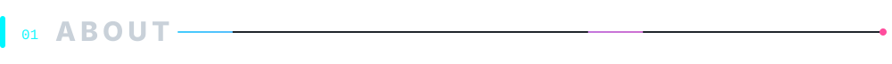

<table>
<tr>
<td width="56%" valign="top">

```yaml
name      : H.K.B. Danupa Chithsara
nicknames : DanuZz • DaNuX • DXZ
age       : <!--AGE-->16<!--/AGE--> years old
location  : Sri Lanka
status    : Student & Developer
learning  : Node.js • React • Python • AI
asks_me   : Apps • APIs • Bots • Automation
reach_me  : danuz.dev@gmail.com
fun_fact  : Anime lover | Code 24/7
```

</td>
<td width="44%" align="center" valign="middle">


</td>
</tr>
</table>

I'm **Danu'Zz**, a student developer from **Sri Lanka** who loves turning ideas into working products. I build **WhatsApp bots, Telegram tools, scraper APIs and full web apps**, a night-owl coder fuelled by anime and lo-fi beats. My goal is simple: **build tools that thousands of people actually use.**

<div align="center">


</div>

<div align="center">
</div>

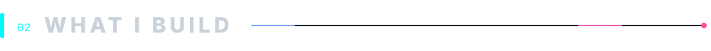

<div align="center">
</div>

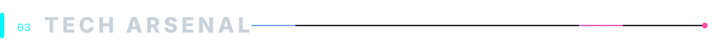

<div align="center">

<br/>

| Area | Icons | Technologies |
| :-- | :-- | :-- |
| **Languages** |  | `JavaScript` `TypeScript` `Python` `Go` `C++` `C#` `Java` `Rust` |
| **Frontend** |  | `React` `Next.js` `HTML` `CSS` `Tailwind CSS` |
| **Backend** |  | `Node.js` `Express` `FastAPI` `REST` `GraphQL` |
| **Data** |  | `MongoDB` `MySQL` `PostgreSQL` `Firebase` `Supabase` |
| **Cloud and tools** |  | `Docker` `Git` `GitHub` `Vercel` `AWS` `GCP` `VS Code` |

</div>

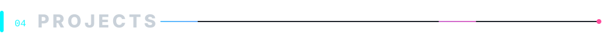

<div align="center">
<table>
<tr>
<td><a href="https://www.movanest.xyz/">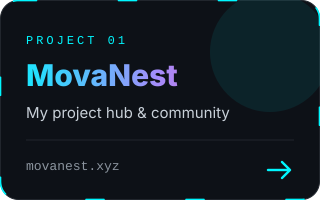</a></td>
<td><a href="https://dnuz.top">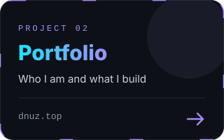</a></td>
<td><a href="https://github.com/dnuzi?tab=repositories"></a></td>
</tr>
</table>
</div>

> Not every project has to become a giant platform. Some exist to explore an idea, a tool or a new way of building.

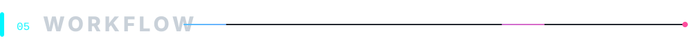

<div align="center">
</div>

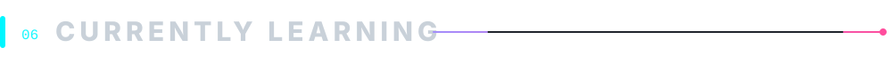

<div align="center">
</div>


<div align="center">
</div>

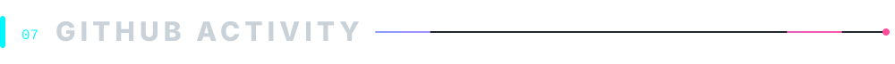

<div align="center">


<br/><br/>


<br/><br/>

<picture>
  <source media="(prefers-color-scheme: dark)" srcset="https://raw.githubusercontent.com/dnuzi/dnuzi/output/github-snake-dark.svg" />
  <source media="(prefers-color-scheme: light)" srcset="https://raw.githubusercontent.com/dnuzi/dnuzi/output/github-snake.svg" />
  
</picture>

</div>

<details>
<summary><b>Want to collaborate on a project?</b></summary>

<br/>

Yes, I'm always open to **portfolio, MovaNest and open-source** collaborations. Email **[danuz.dev@gmail.com](mailto:danuz.dev@gmail.com)** with a short description of your idea.

</details>

<details>
<summary><b>What can you build?</b></summary>

<br/>

WhatsApp and Telegram bots, scraper and REST APIs, automation scripts, and full web apps with React and Next.js.

</details>


<div align="center">


<br/>

<a href="mailto:danuz.dev@gmail.com"></a>
<a href="https://github.com/dnuzi"></a>
<a href="https://www.dnuz.top"></a>
<a href="https://www.movanest.xyz/"></a>

<br/><br/>


</div>
