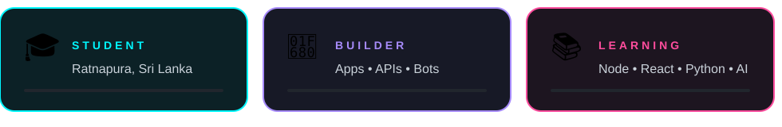

<div align="center">




<br/>

<a href="https://www.movanest.xyz/"></a>
<a href="mailto:danuz.dev@gmail.com"></a>
<a href="https://dnuz.top"></a>
<a href="https://github.com/dnuzi"></a>



</div>

## 👤 About Me

<table>
<tr>
<td width="62%" valign="top">

```yaml
name      : H.K.B. Danupa Chithsara
nicknames : DanuZz • Danu Bbh • Danu • DaNuX • DXZ
age       : <!--AGE-->16<!--/AGE--> years old
birthday  : 31st May 2010 🎂
location  : Ratnapura, Sabaragamuwa Province, Sri Lanka 🇱🇰
status    : Student & Developer 🚀
learning  : Node.js • React • Python • AI
asks_me   : Apps • APIs • Bots • Automation
reach_me  : danuz.dev@gmail.com
fun_fact  : App Builder 🤖 | Anime Lover ❤️ | Code 24/7
```

</td>
<td width="38%" align="center" valign="middle">


</td>
</tr>
</table>

<!-- School (uncomment if you want it public):
🏫 R/Dharmaloka College, Pelmadulla
-->

<div align="center">

</div>

### ✨ A little more about me

- 🌟 A **cute & fronted developer** from Sri Lanka who loves turning ideas into working products
- 🤖 I build **WhatsApp bots, Telegram tools, scraper APIs and full web apps**
- 🎓 Student by day, **night-owl coder** by night 🌙
- 🌏 Proud to represent **Sri Lanka** in the open-source world
- 🤝 Open to collaborating on **Portfolio • MovaNest • Open-Source projects**
- 🎌 Anime and lo-fi beats power my best commits
- 🚀 Goal: build tools that thousands of people actually use


## 🛠️ Tech Stack

<div align="center">

</div>


## 📊 GitHub Stats

<div align="center">


<br/>


</div>


## 🐍 Contribution Snake

<div align="center">
<picture>
  <source media="(prefers-color-scheme: dark)" srcset="https://raw.githubusercontent.com/dnuzi/dnuzi/output/github-snake-dark.svg" />
  <source media="(prefers-color-scheme: light)" srcset="https://raw.githubusercontent.com/dnuzi/dnuzi/output/github-snake.svg" />
  
</picture>
</div>


## 👀 Visitor's Count

<div align="center">

</div>


## 🔗 Connect With Me

<div align="center">

<a href="mailto:danuz.dev@gmail.com"></a>
<a href="https://github.com/dnuzi"></a>
<a href="https://www.dnuz.top"></a>


</div>
